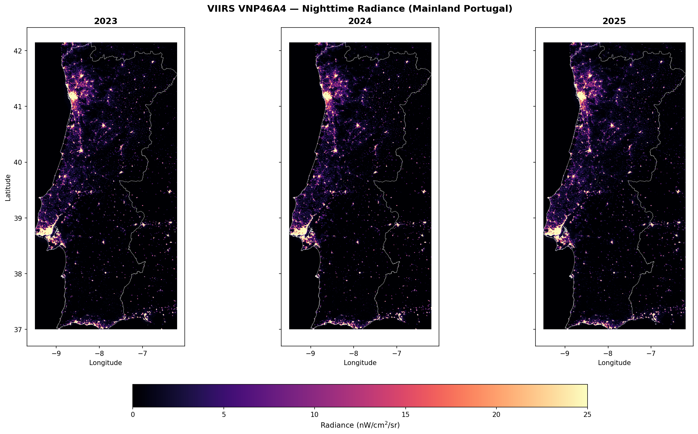

# Dark Sky Observatory

Satellite-derived dark-sky mapping pipeline: ingests VIIRS VNP46A4 nighttime radiance, applies PSF skyglow propagation and multi-criteria scoring, outputs ranked stargazing locations for Portugal.

[](https://github.com/vcygni/darksky-observatory/actions/workflows/ci.yml)
[](https://www.python.org/downloads/)
[](https://www.apache.org/licenses/LICENSE-2.0)

3-year VIIRS median (2023-2025) on a 15 arc-second grid, scored by a 6-factor SSI combining PSF-predicted SQM, ERA5 hourly clear-night fraction, vegetation-aware sky view factor, land cover, slope and elevation. The PSF scale is fitted to 16 TESS photometer pixels; leave-one-out MAE 0.593 mag (see [validation](docs/validation_report.md)). Each spot gets a drivable access point (OSRM car rules + Portuguese traffic code) from a local OpenStreetMap extract.



## Quick Start

```bash
git clone https://github.com/vcygni/darksky-observatory.git
cd darksky-observatory
make install
make test            # 117 tests, no data needed
cp apps/stargazing_spots/.env.example apps/stargazing_spots/.env
# Add EARTHDATA_TOKEN + EDH_TOKEN
make download-data   # ~2 GB terrain tiles
make download-osm    # ~425 MB OpenStreetMap extract
make boundary        # Portugal land boundary from the extract
make run             # ~2 min with local data and cached cloud climatology
make validate
```

## Results

| Metric | Value |
|--------|-------|
| Spots | 597 (469 mainland, 56 Madeira, 72 Azores) |
| Predicted SQM range | 19.82 - 21.95 mag/arcsec² |
| Drive-to spots (road ≤ 358 m) | 290 (walk median 64 m) |
| TESS clear-sky, fitted (in-sample) | MAE 0.555 mag, bias +0.138, r 0.722 (16 pixels) |
| TESS clear-sky, leave-one-out | MAE 0.593 mag (16 pixels) |
| Published SQM (audited, indicative) | MAE 0.066 mag (2 sites) |
| Official observation points → nearest spot | median 5.9 km, max 67.5 km (18 points) |

Spots are the upper class of a two-class SSI split within each region ([methodology §9](docs/methodology.md#9-ssi-and-selection)).


## Project Structure

```
darksky-observatory/
├── apps/stargazing_spots/          # Pipeline (23 modules) and tests
├── scripts/                        # Boundary, TESS, calibration, validation, thresholds
├── notebooks/portugal/             # Analysis notebooks (3)
├── validation/portugal/            # Ground-truth data
├── docs/                           # Methodology, architecture, data sources, validation
├── Makefile
└── pyproject.toml                  # uv workspace root
```

## Data Sources

| Dataset | Provider | Resolution |
|---------|----------|-----------|
| Nighttime lights | NASA LP DAAC (VNP46A4) | 15 arc-seconds, annual |
| Cloud cover | ECMWF ERA5 hourly (Earth Data Hub) | 0.25° |
| Elevation | Copernicus GLO-30 | 30 m |
| Forest canopy | Hansen GFC | 30 m |
| Land cover | ESA WorldCover | 10 m |
| Points of interest, roads, boundary | OpenStreetMap | Vector |
| Validation | Stars4All TESS photometers | Point |

Licences: [docs/data-sources.md](docs/data-sources.md).

## Methodology

Power-law PSF (Walker's law, distance^-2.5) convolved with VIIRS radiance via FFT over 200 km, scaled by a factor fitted to TESS. Clear-night fraction: share of astronomically dark hours (2006-2025) with ERA5 total cloud cover below 0.2. Sky view factor from Copernicus DEM and Hansen canopy. A weighted linear combination gives a 0-100 SSI per spot. Weights, ranges and cut-offs are design choices.

Full methodology: [docs/methodology.md](docs/methodology.md)

## Limitations

- One fitted scale factor; the PSF has no aerosol, humidity or wavelength terms.
- Validation: 15 of the 16 TESS pixels are town sites in Extremadura (Spain), 1 is in Porto; only 4 are as dark as the ranked spots. Rank agreement is moderate (Spearman ρ 0.60).
- Three years of VIIRS show inter-annual variability, not trends.
- ERA5 at 0.25° does not resolve valley fog or sub-km microclimates.

## License

Apache 2.0
