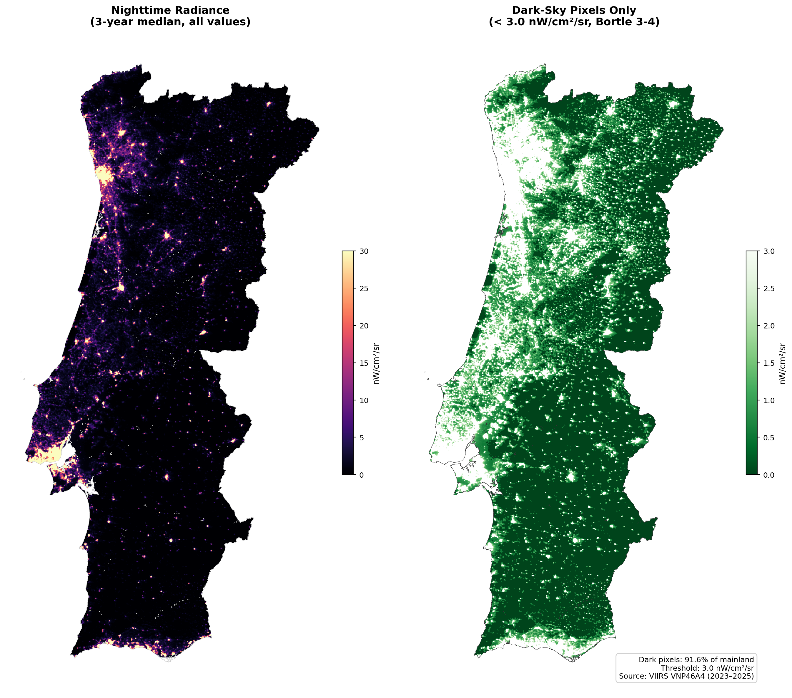
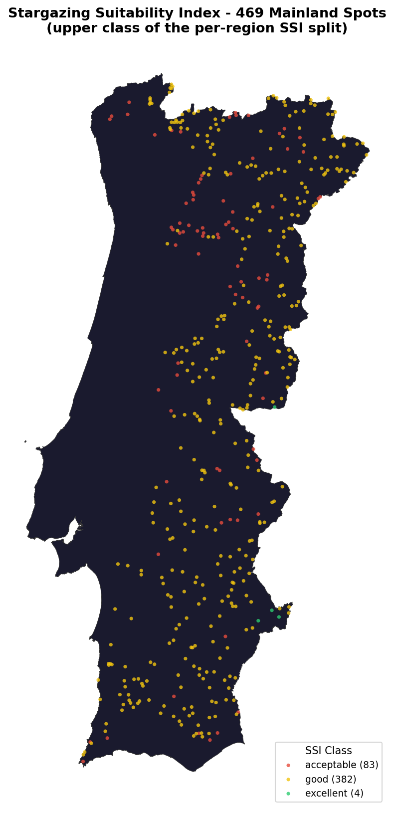

# Dark Sky Observatory

Satellite-derived dark-sky mapping pipeline: ingests VIIRS VNP46A4 nighttime radiance, applies PSF skyglow propagation and multi-criteria scoring, outputs ranked stargazing locations.

[](https://github.com/cygniv404/darksky-observatory/actions/workflows/ci.yml)
[](https://www.python.org/downloads/)
[](https://www.apache.org/licenses/LICENSE-2.0)
[](https://stacspec.org/)

3-year VIIRS median (2023-2025) at 500m resolution, scored by a 6-factor SSI combining PSF-predicted SQM, ERA5 hourly cloud climatology, vegetation-aware SVF, land cover, slope, and elevation. Checked against 16 TESS photometer pixels (clear-sky moonless zenith): MAE 0.683 mag, bias +0.55 mag with the current calibration; leave-one-out MAE 0.593 mag (see [validation](docs/validation_report.md)). Each spot gets a drivable access point (OSRM car rules + Portuguese traffic code) from a local OpenStreetMap extract.



## Quick Start

```bash
git clone https://github.com/cygniv404/darksky-observatory.git
cd darksky-observatory
make install
make test            # 120 tests, no data needed
cp apps/stargazing_spots/.env.example apps/stargazing_spots/.env
# Add EARTHDATA_TOKEN + CDS_API_KEY
make download-data   # ~2GB terrain tiles
make download-osm    # ~425MB OpenStreetMap extract (candidates + access points)
make run             # ~36s with local data
```

## Architecture


## Results

| Metric | Value |
|--------|-------|
| Total spots (SSI >= 65) | 658 (542 mainland + 37 Madeira + 79 Azores) |
| SQM range | 20.56 - 22.06 |
| Drive-to spots (road ≤ 358 m) | 316 (walk median 67.5 m) |
| TESS clear-sky, current calibration | MAE 0.683 mag, bias +0.552, r 0.736 (16 pixels) |
| TESS clear-sky, leave-one-out | MAE 0.593 mag (16 pixels) |
| Published SQM (audited, indicative) | MAE 0.191 mag (2 sites) |
| Official observation points → nearest spot | median 4.2 km, max 31.9 km (18 points) |

Full validation details: [docs/validation_report.md](docs/validation_report.md)




## Project Structure

```
darksky-observatory/
├── apps/stargazing_spots/          # Core EO pipeline (23 modules)
├── notebooks/portugal/             # Analysis notebooks (3)
├── validation/portugal/            # Ground-truth data
├── docs/                           # Methodology, architecture, validation
├── Makefile
└── pyproject.toml                  # uv workspace root
```

## Data Sources

| Dataset | Provider | Resolution |
|---------|----------|-----------|
| Nighttime Lights | NASA LP DAAC (VNP46A4) | 500m annual |
| Cloud Climatology | ECMWF ERA5 hourly | 0.25° |
| Digital Elevation | Copernicus GLO-30 | 30m |
| Forest Canopy | Hansen GFC | 30m |
| Land Cover | ESA WorldCover | 10m |
| Points of Interest | OpenStreetMap | Vector |

## Methodology

PSF skyglow model (Garstang 1986, Duriscoe 2018 softening) predicts clear-sky SQM via FFT convolution over 200km radius. Clear-night fraction: share of astronomically dark hours (2006-2025) with ERA5 total cloud cover below 0.2. SVF computed from DEM + Hansen canopy. Weighted linear combination produces a 0-100 SSI per spot.

Full methodology: [docs/methodology.md](docs/methodology.md)

## Limitations

- PSF model carries +/-0.5 mag systematic uncertainty vs full radiative transfer. Against TESS the model predicts darker skies than measured (bias +0.55 mag); rank agreement is moderate (Spearman ρ 0.60, 16 pixels).
- Validation sample: 15 of 16 TESS pixels are town sites in Extremadura (Spain), 1 is in Porto; only 4 are as dark as the ranked spots.
- `CALIB_FACTOR` has no reproducible fit in the repository; a TESS refit gives a 1.76× larger value (not adopted). Other regions require re-fitting.
- 3-year radiance variability is indicative, not a statistically significant trend (Kyba et al. 2017: need 5+ years).
- Cloud data at 5-25km cannot resolve valley fog or sub-km microclimates.

## License

Apache 2.0
